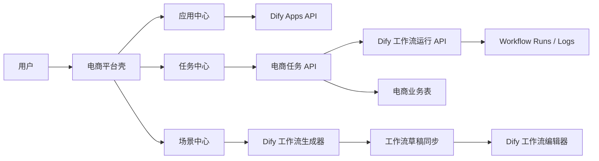

# 电商 AI 经营平台技术设计

日期：2026-07-08

状态：研发评审草案

关联需求文档：`docs/design/ecommerce-ai-platform/requirements.md`

## 1. 技术定位

本项目应以增量方式在 Dify 之上实现电商业务层。

MVP 阶段不重写以下 Dify 能力：

- 工作流画布渲染与编辑。
- 工作流图生成。
- 应用创建与草稿同步。
- 工作流执行。
- 工作流运行日志。
- 模型、工具、Provider 管理。
- 工作空间认证与权限。

新增模块聚焦：

- 任务类型。
- 任务实例。
- 任务 SOP 步骤状态。
- 商品与竞品上下文。
- 任务产物。
- 场景中心 UI，并驱动 Dify 已有工作流生成器。

## 2. 需要复用的现有能力

### 2.1 应用列表

现有入口：

- `web/app/(commonLayout)/apps/page.tsx`
- `web/app/components/apps/index.tsx`
- `web/app/components/apps/list.tsx`
- `web/app/components/apps/app-card.tsx`

当前应用列表已经具备分页、搜索、标签、创建人筛选、排序、创建弹窗和权限校验。电商应用中心应优先复用这些数据流和权限逻辑，只做业务视角封装和样式扩展。

### 2.2 工作流编辑器

现有入口：

- `web/app/(commonLayout)/app/(appDetailLayout)/[appId]/workflow/page.tsx`
- `web/app/components/workflow-app/index.tsx`
- `web/app/components/workflow/index.tsx`

设计稿中的画布能力在 MVP 阶段应映射到 Dify Workflow Studio。

### 2.3 工作流生成器

后端：

- `api/controllers/console/app/generator.py`
- `api/services/workflow_generator_service.py`

前端：

- `web/app/components/workflow/workflow-generator/*`
- `web/service/debug.ts`

关键接口：

- `POST /console/api/workflow-generate`
- `POST /console/api/workflow-generate/stream`
- `POST /console/api/workflow-generate/suggestions`

流式接口会先返回 plan 事件，再返回 result 事件，并已具备空提示词、超长提示词等边界校验。

### 2.4 应用创建与图应用

现有前端流程：

- `web/app/components/workflow/workflow-generator/apply.ts`

已有能力：

- 创建 Dify 应用。
- 将生成的工作流图同步到 `apps/{appId}/workflows/draft`。
- 如果图同步失败，尽量回滚新建应用。
- 应用到当前应用时检测草稿 hash 冲突。

场景中心应复用这套逻辑，必要时抽取为共享 helper。

### 2.5 工作流运行与日志

模型：

- `api/models/workflow.py` 中的 `Workflow`、`WorkflowRun`、`WorkflowAppLog`

前端与服务：

- `web/app/components/app/workflow-log/index.tsx`
- `web/service/use-log.ts`
- `web/service/log.ts`

任务执行应保存 Dify workflow_run_id 引用，不复制完整运行日志。

## 3. 总体架构



数据归属：

- Dify 拥有 app、workflow、workflow_run 等核心记录。
- 电商层拥有 task、product、competitor、artifact、SOP 状态等业务记录。
- 电商记录通过 app_id、workflow_id、workflow_run_id 等字段关联 Dify 数据。

## 4. 前端设计

### 4.1 新增路由与目录

建议新增：

```text
web/app/(commonLayout)/tasks/page.tsx
web/app/(commonLayout)/tasks/[taskId]/page.tsx
web/app/(commonLayout)/scene-center/page.tsx
web/app/components/ecommerce/shell/
web/app/components/ecommerce/tasks/
web/app/components/ecommerce/scene-center/
web/app/components/ecommerce/artifacts/
web/service/ecommerce-tasks.ts
web/service/ecommerce-scenes.ts
web/types/ecommerce-task.ts
web/types/ecommerce-scene.ts
```

原则：

- 电商组件尽量放在 `web/app/components/ecommerce/*`。
- 不把电商业务代码散落进 Dify 核心组件，除非该变化是通用能力。
- 与 Dify 现有组件交互时，通过 service、hook 或明确 props 边界连接。

### 4.2 导航改造

需要修改：

- `web/app/components/main-nav/routes.ts`
- `web/app/components/main-nav/index.tsx`
- `web/i18n/zh-Hans/common.json`

建议新增导航配置：

```ts
{
  key: 'tasks',
  href: '/tasks',
  labelKey: 'menus.tasks',
  active: path => isPathUnderRoute(path, '/tasks'),
  icon: 'i-ri-task-line',
  activeIcon: 'i-ri-task-fill',
  visibility: 'all',
}
{
  key: 'scene-center',
  href: '/scene-center',
  labelKey: 'menus.sceneCenter',
  active: path => isPathUnderRoute(path, '/scene-center'),
  icon: 'i-ri-sparkling-line',
  activeIcon: 'i-ri-sparkling-fill',
  visibility: 'all',
}
```

待决策：

- 是否保留 Dify 首页、知识库、集成、市场等入口。
- 是否仅管理员或高级用户可见原 Dify 管理入口。

### 4.3 应用中心

两种实现方式：

1. 低风险方式：包裹现有 `Apps` 列表，改造 header 和 card 样式。
2. 高控制方式：新增 `EcommerceAppCenter`，复用 `consoleQuery.apps.get` 等数据源。

推荐：

- 如果视觉差异可控，优先方式 1。
- 如果设计稿结构与现有列表差异较大，使用方式 2，但复用现有 hook 和服务：
  - `useAppsQueryState`
  - `consoleQuery.apps.get`
  - `normalizeAppPagination`
  - `AppListCreationModals`

避免重写应用列表接口和权限逻辑。

### 4.4 场景中心

场景中心状态机：

```text
idle
  -> collecting_prompt
  -> generating_plan
  -> generating_graph
  -> preview_ready
  -> publishing
  -> published
  -> open_workflow_studio
```

前端调用：

- 获取示例提示词：`fetchWorkflowInstructionSuggestions`
- 流式生成工作流：`generateWorkflowStream`
- 创建新应用并同步图：复用 `applyToNewApp`

附件处理：

- MVP 可以先实现附件 UI，但如果后端尚不消费附件，不应在生产文案中暗示附件已参与生成。
- 如果附件暂不参与生成，应隐藏入口或明确标注为待支持。

### 4.5 任务中心

任务列表数据类型：

```ts
type EcommerceTaskSummary = {
  id: string
  tenantId: string
  name: string
  description: string
  taskTypeId: string
  taskTypeName: string
  status: 'draft' | 'running' | 'waiting_for_input' | 'succeeded' | 'failed' | 'stopped'
  productName?: string
  appId?: string
  workflowRunId?: string
  createdAt: string
  updatedAt: string
}
```

任务详情数据类型：

```ts
type EcommerceTaskDetail = EcommerceTaskSummary & {
  product?: EcommerceProduct
  steps: EcommerceTaskStep[]
  artifacts: EcommerceTaskArtifact[]
}
```

### 4.6 任务详情

页面结构：

- 左侧或中间：SOP 步骤内容与产物。
- 右侧：执行助手、执行流或运行进度。
- 顶部：任务信息、操作按钮、视图模式。

建议 MVP 先实现单一稳定视图，不急于实现设计稿中的多模式切换。待任务数据、步骤状态、产物持久化稳定后，再实现：

- 对话模式。
- 协作模式。
- 沉浸式报告模式。

## 5. 后端设计

### 5.1 新增模块

建议新增：

```text
api/models/ecommerce.py
api/controllers/console/ecommerce/__init__.py
api/controllers/console/ecommerce/tasks.py
api/controllers/console/ecommerce/task_types.py
api/controllers/console/ecommerce/scenes.py
api/services/ecommerce_task_service.py
api/services/ecommerce_scene_service.py
api/migrations/versions/<revision>_add_ecommerce_task_tables.py
```

如果业务继续扩大，再按 product、artifact、competitor 拆分模型和服务文件。

### 5.2 数据模型

#### `ecommerce_task_types`

用途：存储可复用任务类型和 SOP 定义。

| 字段 | 类型 | 说明 |
| --- | --- | --- |
| id | uuid | 主键 |
| tenant_id | uuid nullable | 空表示系统内置，非空表示租户自定义 |
| code | string | 稳定编码，例如 `search_main_image_planning` |
| name | string | 展示名称 |
| description | text | 描述 |
| icon | string nullable | emoji 或图标 key |
| icon_background | string nullable | 卡片背景 |
| sop_schema | json | 有序步骤定义 |
| default_app_id | uuid nullable | 可选模板应用 |
| enabled | bool | 是否可见 |
| created_at | datetime | 创建时间 |
| updated_at | datetime | 更新时间 |

索引：

- `(tenant_id, code)` 唯一。
- `(enabled)`。

#### `ecommerce_tasks`

用途：存储任务实例。

| 字段 | 类型 | 说明 |
| --- | --- | --- |
| id | uuid | 主键 |
| tenant_id | uuid | 工作空间边界 |
| created_by | uuid | 创建人 account_id |
| task_type_id | uuid | 任务类型 |
| app_id | uuid nullable | 关联 Dify 应用 |
| workflow_id | uuid nullable | 关联 Dify 工作流 |
| workflow_run_id | uuid nullable | 最近或主运行记录 |
| name | string | 任务名称 |
| description | text | 任务描述 |
| status | string | `draft`、`running`、`waiting_for_input`、`succeeded`、`failed`、`stopped` |
| current_step_code | string nullable | 当前 SOP 步骤 |
| product_id | uuid nullable | 关联商品 |
| inputs | json | 任务输入快照 |
| outputs | json | 任务输出摘要 |
| error | text nullable | 最近失败原因 |
| created_at | datetime | 创建时间 |
| updated_at | datetime | 更新时间 |
| finished_at | datetime nullable | 完成时间 |

索引：

- `(tenant_id, created_at)`
- `(tenant_id, status)`
- `(tenant_id, task_type_id)`
- `(workflow_run_id)`

#### `ecommerce_task_steps`

用途：存储任务步骤状态。

| 字段 | 类型 | 说明 |
| --- | --- | --- |
| id | uuid | 主键 |
| task_id | uuid | 父任务 |
| step_code | string | 稳定步骤编码 |
| name | string | 步骤名称快照 |
| order | int | SOP 顺序 |
| status | string | `pending`、`running`、`waiting_for_input`、`succeeded`、`failed`、`skipped` |
| workflow_node_id | string nullable | 对应 Dify 节点 |
| workflow_run_id | uuid nullable | 产生该步骤的运行 |
| node_execution_id | uuid nullable | 节点执行记录 |
| inputs | json | 步骤输入快照 |
| outputs | json | 步骤输出快照 |
| error | text nullable | 步骤失败原因 |
| started_at | datetime nullable | 开始时间 |
| finished_at | datetime nullable | 完成时间 |

唯一约束：

- `(task_id, step_code)`

#### `ecommerce_products`

用途：存储商品上下文。

| 字段 | 类型 | 说明 |
| --- | --- | --- |
| id | uuid | 主键 |
| tenant_id | uuid | 工作空间边界 |
| created_by | uuid | 创建人 |
| name | text | 商品名称 |
| description | text nullable | 商品描述 |
| platform | string nullable | 平台，如淘宝、天猫、京东 |
| category | string nullable | 类目 |
| source_url | text nullable | 来源链接 |
| image_file_ids | json | 已上传图片文件 ID |
| raw_data | json | 原始导入数据 |
| created_at | datetime | 创建时间 |
| updated_at | datetime | 更新时间 |

#### `ecommerce_competitors`

用途：存储竞品候选与选择结果。

| 字段 | 类型 | 说明 |
| --- | --- | --- |
| id | uuid | 主键 |
| task_id | uuid | 父任务 |
| product_id | uuid nullable | 关联商品 |
| name | text | 竞品名称 |
| source_url | text nullable | 来源链接 |
| image_file_id | uuid nullable | 图片 |
| metrics | json | 销量、排名等指标 |
| selected | bool | 是否被用户选择 |
| raw_data | json | 原始数据 |
| created_at | datetime | 创建时间 |

#### `ecommerce_task_artifacts`

用途：存储步骤产物和报告。

| 字段 | 类型 | 说明 |
| --- | --- | --- |
| id | uuid | 主键 |
| task_id | uuid | 父任务 |
| step_id | uuid nullable | 产生该产物的步骤 |
| workflow_run_id | uuid nullable | Dify 运行记录 |
| node_execution_id | uuid nullable | Dify 节点执行记录 |
| type | string | `report`、`strategy_card`、`image`、`table`、`file`、`text`、`link` |
| title | string | 展示标题 |
| content | json/text | 产物内容 |
| file_id | uuid nullable | Dify 上传文件 |
| created_at | datetime | 创建时间 |

### 5.3 API 设计

基础路径：

```text
/console/api/ecommerce
```

任务类型：

```http
GET /console/api/ecommerce/task-types
POST /console/api/ecommerce/task-types
PATCH /console/api/ecommerce/task-types/{task_type_id}
```

任务：

```http
GET /console/api/ecommerce/tasks?page=1&limit=30&status=running&task_type_id=...
POST /console/api/ecommerce/tasks
GET /console/api/ecommerce/tasks/{task_id}
PATCH /console/api/ecommerce/tasks/{task_id}
POST /console/api/ecommerce/tasks/{task_id}/run
POST /console/api/ecommerce/tasks/{task_id}/stop
POST /console/api/ecommerce/tasks/{task_id}/steps/{step_code}/confirm
POST /console/api/ecommerce/tasks/{task_id}/steps/{step_code}/retry
```

商品：

```http
POST /console/api/ecommerce/products
GET /console/api/ecommerce/products?keyword=...
GET /console/api/ecommerce/products/{product_id}
```

产物：

```http
GET /console/api/ecommerce/tasks/{task_id}/artifacts
GET /console/api/ecommerce/tasks/{task_id}/artifacts/{artifact_id}
```

### 5.4 任务运行流程

MVP 建议流程：

1. 校验任务所属 tenant 和用户权限。
2. 解析任务类型和关联的 Dify 应用或工作流。
3. 根据任务、商品、步骤数据构造 workflow inputs。
4. 通过 Dify 现有能力启动工作流运行。
5. 将返回的 `workflow_run_id` 保存到任务。
6. 通过轮询或事件更新运行状态。
7. 更新任务和步骤状态。
8. 将可识别输出提取为 artifact。

关键约束：

- 不把完整 workflow run log 复制到电商表。
- 只保存业务摘要、产物和 Dify run/node execution 引用。

## 6. 权限设计

初始映射：

| 操作 | 权限建议 |
| --- | --- |
| 查看任务列表 | 工作空间成员且具备应用可见性 |
| 创建任务 | 复用应用创建/管理权限，或后续新增任务权限 |
| 编辑自己的任务 | 创建人或应用管理者 |
| 运行任务 | 创建人或具备应用测试运行能力的用户 |
| 查看工作流运行链接 | 通过现有 Dify app/run 权限 |
| 创建场景/应用 | 复用 `app.create_and_management` |

MVP 建议：

- 优先复用 Dify 权限。
- 等主要流程稳定后再新增电商专属权限 key。

## 7. 迁移与种子数据

迁移应只新增表，不改变 Dify 核心表语义。

初始任务类型：

```json
[
  {
    "code": "search_main_image_planning",
    "name": "搜索主图策划",
    "steps": ["main_image_plan", "visual_strategy", "image_generation"]
  },
  {
    "code": "opportunity_discovery",
    "name": "商机发现",
    "steps": ["keywords", "persona", "competitors", "reviews", "opportunity_report"]
  }
]
```

回滚策略：

- 仅在确认不需要保留生产任务数据时删除电商业务表。
- 回滚不删除 Dify `apps`、`workflows`、`workflow_runs`。

## 8. 安全与数据边界

规则：

- 所有查询必须过滤 `tenant_id`。
- 所有任务更新必须校验 tenant 和权限。
- 商品或产物中的 file_id 必须属于同一 tenant，并满足现有文件访问约束。
- 不通过普通后端接口直接抓取任意外部 URL，除非接入 SSRF 安全的抓取层。
- 电商表不存储 Provider 密钥。
- 默认不向前端暴露 `raw_data`，除非接口明确需要。

高风险区域：

- 商品外链导入。
- 竞品数据采集。
- 报告导出。
- 附件进入模型提示词。

## 9. 性能设计

- 任务列表默认分页，建议 `limit=30`。
- 大型产物延迟加载。
- 大型报告建议存文件存储，数据库只存元数据。
- 任务详情首屏不加载全部节点执行日志。
- 实时执行优先使用 SSE 或轻量轮询。

## 10. 测试策略

前端测试：

- 导航可见性。
- 应用中心搜索和筛选不破坏原应用列表行为。
- 场景中心提示词校验和生成失败态。
- 任务列表筛选和空状态。
- 任务详情步骤状态流转。

后端测试：

- 任务 API 的 tenant 隔离。
- 任务创建参数校验。
- 步骤状态流转规则。
- 任务运行后正确关联 workflow_run_id。
- 权限拒绝场景。
- 数据库迁移升级和回滚冒烟测试。

E2E 测试：

1. 从提示词创建场景，发布为工作流应用，并打开工作流编辑器。
2. 从任务类型创建任务，关联商品，运行任务，看到状态更新。
3. 生成失败时显示可恢复错误，不创建孤儿任务。
4. 无创建权限用户不能创建场景、应用或任务。

视觉验证：

- 使用 Playwright 对应用中心、场景中心、任务列表、任务详情截图。
- 覆盖桌面和移动端，检查文字溢出、元素重叠、按钮可点击区域。

## 11. 上线计划

阶段 1：

- 增加路由、导航文案和应用中心改造。
- 增加场景中心并接入现有生成器。
- 如果后端未完成，任务中心可先放在开发开关后。

阶段 2：

- 新增电商表和任务 API。
- 任务中心接真实持久化。
- 任务关联 Dify app 和 workflow_run。

阶段 3：

- 增加商品导入、竞品选择、步骤产物。
- 增加报告展示和必要导出能力。

阶段 4：

- 增加真实电商数据连接器和专用工具。

## 12. 压力测试

### 阻塞项

- 需要产品确认：MVP 任务产物是否必须由真实工作流运行生成。
- 需要确定合规可用的电商数据源和模型/工具提供方。
- 需要定义应用中心“获取”的真实语义。

### 可控风险

- UI 范围容易扩张。MVP 限定为 `/tasks`、`/apps`、`/scene-center` 三个核心入口。
- 工作流生成质量不稳定。通过电商场景提示词模板和示例降低波动。
- 任务类型 schema 后续可能变化。通过 `sop_schema` 和 step 快照保证历史任务可读。
- 原应用中心行为复杂。尽量复用现有 hook、service 和权限逻辑。

### 被拒绝的方案

#### 直接复制 HTML Demo

拒绝原因：HTML Demo 包含静态状态、内联脚本和 mock 数据，直接复制会绕过 Dify 路由、权限、国际化、服务层和测试结构。

#### 重写工作流画布

拒绝原因：Dify 已有完整 React Flow 编辑器、草稿同步、协作相关逻辑和节点执行工具。MVP 重写成本高且风险大。

#### 任务结果只存工作流日志

拒绝原因：业务任务需要稳定的 SOP、商品、竞品、产物概念，这些不是 Dify workflow log 的一等对象。

## 13. 开放实现问题

1. 任务类型模板是否在初始化时绑定到 Dify 模板应用？
2. 一个任务对应一次工作流运行，还是每个步骤对应一次工作流运行？
3. 商品记录是跨任务复用，还是作为任务内快照？
4. 产物内容存数据库 JSON，还是渲染成文件存储？
5. 场景中心是否对所有应用创建者开放，还是受单独 feature flag 控制？
6. 能力中心和经营增长是否在有真实功能前隐藏？

